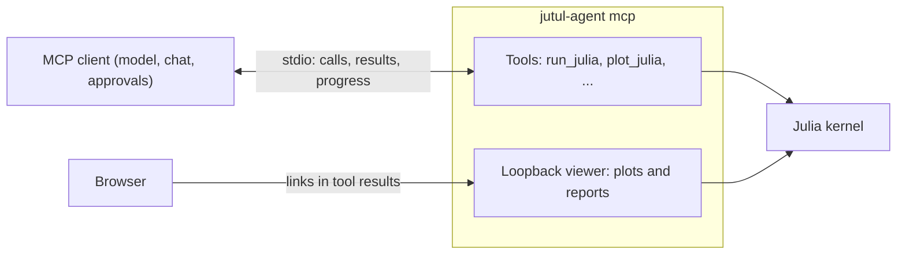

# The MCP interface

`jutul-agent mcp` serves one folder's Julia session to an
[MCP](https://modelcontextprotocol.io) client: an IDE or desktop agent such as
GitHub Copilot, VS Code, or Claude Desktop. The client brings the model, the
chat, and the approval prompts. jutul-agent supplies the part that is specific to
simulation: a persistent Julia session with the simulator loaded, the plotting
pipeline, and the investigation record.



There is no second copy of the tools. The server starts the same session core as
the other interfaces (`start_core`, see [architecture](architecture.md)) and
serves the same tools the bundled agent is given (`build_tools`), so a call does
exactly what it does in the web UI. Calls are recorded in the session's
[trace](trace.md), so `jutul-agent transcript` and the investigation report work
for an MCP session too.

## Connecting a client

A client launches the server as a stdio command. Point it at the folder to work
in, with `--workspace` or by launching it there:

```json
{
  "servers": {
    "jutul-agent": {
      "type": "stdio",
      "command": "jutul-agent",
      "args": ["mcp", "--workspace", "/path/to/simulation-folder"]
    }
  }
}
```

This is VS Code's `mcp.json` shape. Other clients use the same three fields
under their own key (`mcpServers` for Claude Desktop, for example). If
`jutul-agent` is not on the client's `PATH`, give the full path to the
executable. On Windows with the simulator inside WSL, launch it through WSL, with
a login shell so Julia is on `PATH`:

```json
"command": "wsl.exe",
"args": ["--", "bash", "-lc", "jutul-agent mcp --workspace ~/simulation-folder"]
```

From a source checkout, give the full path, `<checkout>/.venv/bin/jutul-agent`.
Viewer links work from a Windows browser too, because WSL forwards localhost
ports to Windows by default.

The folder is set up as for any interface (`jutul-agent init --sim <name>`, or
`--sim` on first launch); see [installation and usage](usage.md). The server
needs no model and no API key. It removes provider keys from its environment, so
code run in the session cannot read them.

## What the client sees

On connecting, the client receives instructions for its model: the simulator and
workspace, how to use the session, and an index of the simulator's skills as
`SKILL.md` paths. The model reads those files on demand with the client's own
file tools, as the bundled agent does with its skills.

The tools:

| Tool | What it does |
|---|---|
| `run_julia` | Evaluate code in the persistent session; state persists across calls |
| `reset_julia` | Restart the Julia process when its state is wedged |
| `plot_julia` | Build a figure: saved as a PNG, served live, linked in the result |
| `recapture_plot` | Snapshot a live plot as the user left it (its view must be open in a browser) |
| `close_plots` | Close live plots |
| `record_attempt` | Log one step of an investigation and its outcome |
| `write_report` | Write an HTML report of the session |

The server answers the handshake at once and starts Julia in the background.
The first call waits until Julia is up, which takes as long as a session start
in any other interface. If Julia cannot start, every call says why, as an error
result the model can read and pass on.

While a call runs, the server forwards its output as MCP progress notifications,
carrying the last finished line of output, at most twice a second. A client
that shows progress lets the user watch a long solve. Cancelling a call from the
client interrupts Julia and waits for the interrupted code to unwind, so the
session stays usable for the next call, with its variables. If the code ignores
the interrupt, Julia restarts. Julia can also restart with no call waiting on
it, when a plot re-fit (a resize in the viewer) overruns and its code ignores
the interrupt. Either way, the next result starts with a note that says when
Julia restarted and why, that earlier variables and imports are gone, and which
live plots no longer update. A `reset_julia` result says so itself.

A text result longer than 32,000 characters (a printed array, a chatty solver
log) would fill the client's context, so it reaches the client as its start
and end, about 28,000 characters cut at line ends. The whole text is saved in
the session's `tool-results/` folder, at a path the result names, and the trace
keeps it whole.

## Plots and reports

An MCP client shows text and images, but not a live WebGL figure. So the server
also runs a small viewer on a loopback port, which serves the same routes as the
web server's plot viewer (`interfaces/server/viewer.py`). A tool result that
produced a plot or report ends with links into it:

```text
Pressure (interactive): http://127.0.0.1:41207/popout/<session-id>?route=pressure&w=1200&h=800
  saved as /path/to/state/sessions/<session-id>/artifacts/plots/pressure.png
```

The interactive link opens the live figure in a browser, where its widgets and
camera work. Open it in one window: a live figure is built for a single view,
and a second window on the same figure can leave clicks and selection
misbehaving. Plotting again (the same `slot` replaces the figure) gives a fresh
one. A live figure lives in the Julia session, so it ends when Julia restarts;
its link then opens a page that says so and why, until a plot in the same
`slot` serves it again. Reports and static plots link to their files. With
`--no-viewer`, results give the saved paths only.

`plot_julia` returns the PNG to the model only when the call asks for it
(`view=true`), as in the other interfaces.

## Security

The server runs code the client's model writes, and nothing in jutul-agent
asks before it does. Approval is the client's job: keep its confirmation prompt
on for these tools unless you trust the work being done. The session runs as
you, with your access to the workspace and the rest of the machine.

The viewer listens on `127.0.0.1` only. Its links carry the session id, which the
server makes unguessable (96 random bits after the date), and the viewer serves
that one session and nothing else. It answers only requests addressed to its own
host and port, and accepts a websocket only from its own pages, so a web page
cannot reach it through DNS rebinding.

## Not included

- The model, chat, and approval prompts, which are the client's.
- The memory tool (`remember`): the client has its own memory, if any.
- Resuming a session. Each server process is a new session. Earlier sessions stay
  on disk and can be read with `jutul-agent transcript`.
- Embedding the live figure in the client's chat window. MCP Apps (interactive
  views a server ships to the client) are the route for that, but the live
  figure's JavaScript compiles code at run time (`new Function`), which an MCP
  App's default content security policy forbids.
